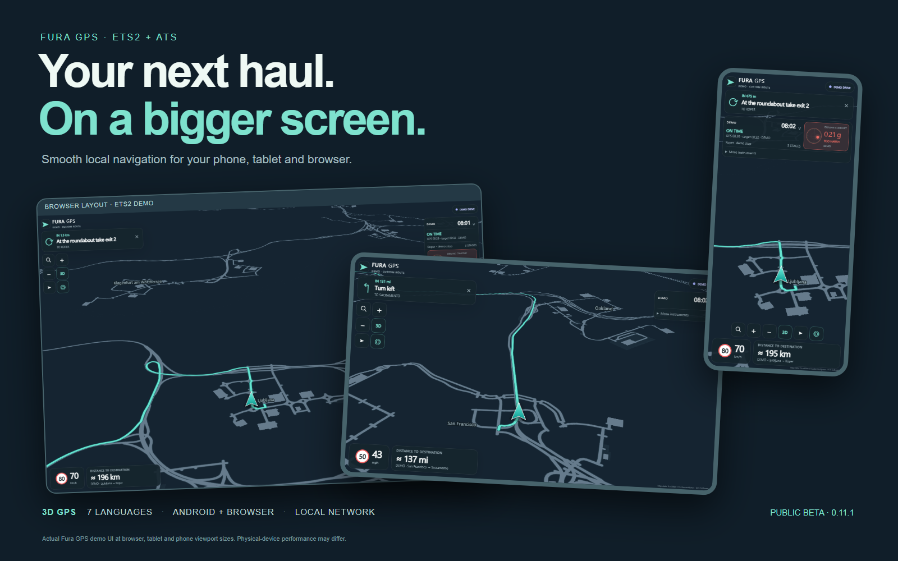
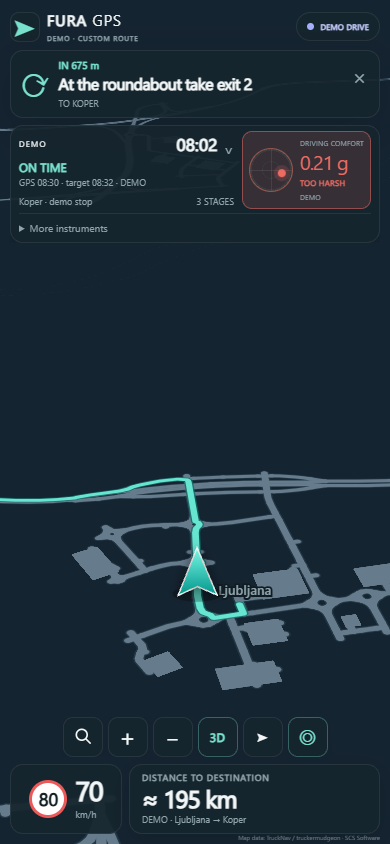
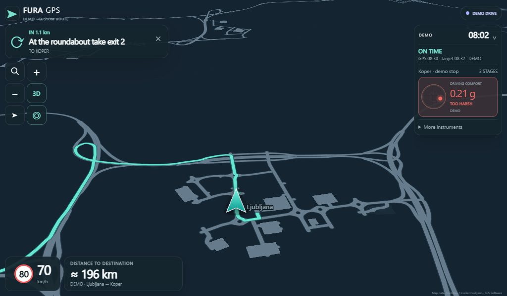
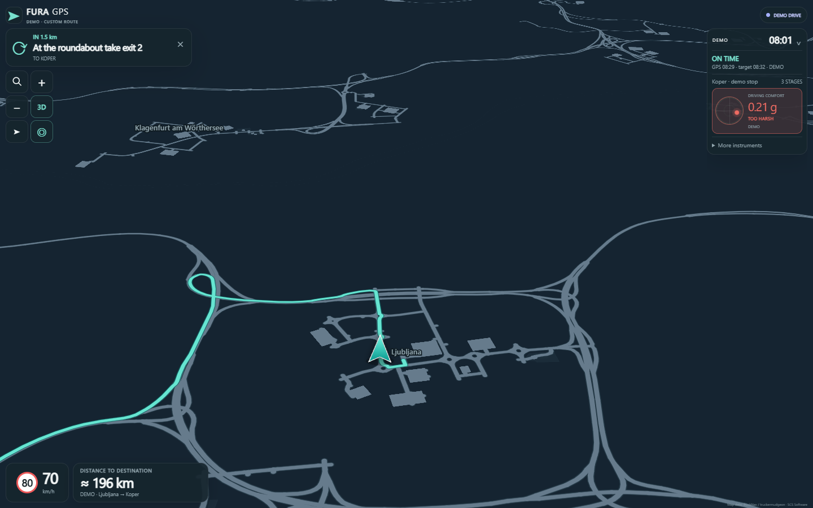
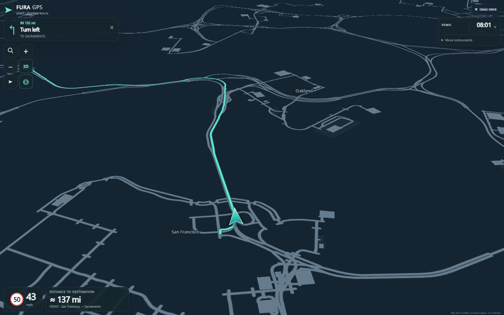
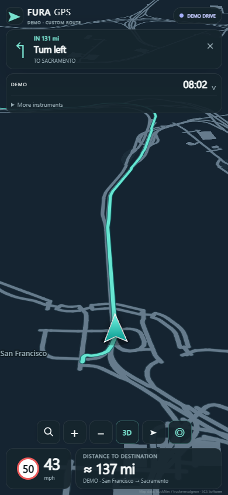
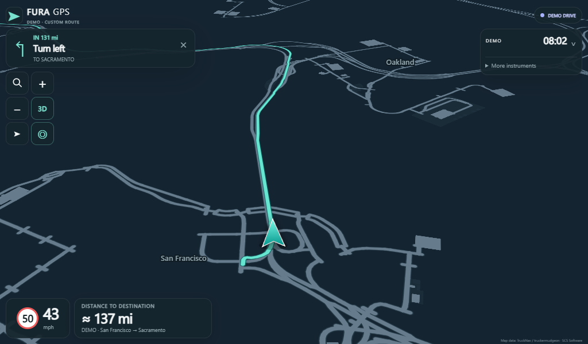
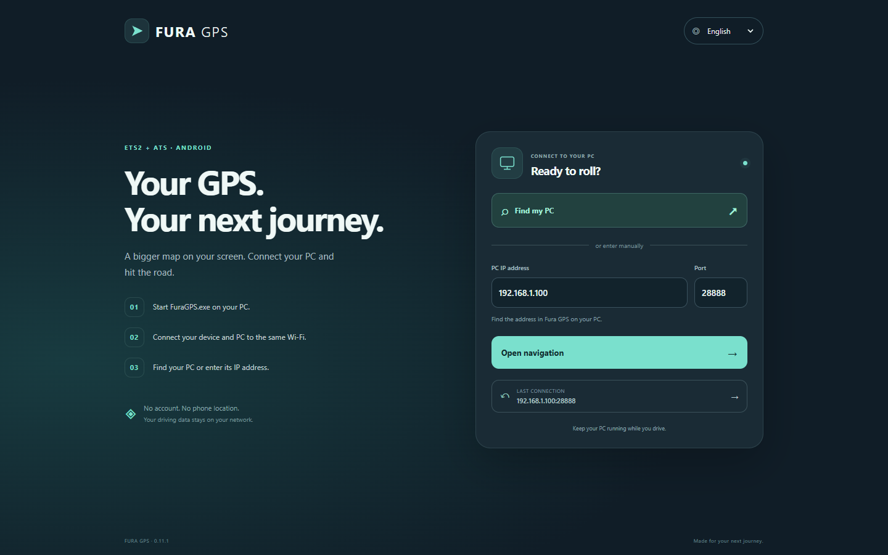

# Fura GPS

**Your next haul, on a bigger screen.**

Fura GPS turns your Android phone, tablet or browser into a dedicated navigation screen for **Euro Truck Simulator 2** and **American Truck Simulator**. Connect over your local network, keep the game on your main display, and follow a smooth 3D map on a second screen.

City search, custom routes, seven languages and experimental ETS2 Coach DLC tools: a G-force comfort meter and live punctuality display — without accounts, ads or distance limits.



[Download Windows](https://github.com/vancopek123/FuraGPS/releases/download/v0.11.1/FuraGPS-Windows-0.11.1.zip) · [Download Android APK](https://github.com/vancopek123/FuraGPS/releases/download/v0.11.1/FuraGPS-Android-0.11.1.apk) · [All releases](https://github.com/vancopek123/FuraGPS/releases)

This is a **public beta**. See the compatibility table below for the distinction between tested components and features that still need real-game/device testing.

## What you get

- **A second-screen GPS:** a heading-up 3D map, 2D view and smooth vehicle tracking.
- **ETS2 and ATS:** separate maps and telemetry, automatic game selection, city search and custom destinations.
- **Experimental in-game routes:** read-only GPS following, including stage changes exposed by the game. Custom routing remains available when reading is unsupported.
- **Optional instruments:** speed, RPM, fuel range, cruise control and available vehicle warnings.
- **G-force comfort meter (beta):** monitor cornering, acceleration and braking with a moving dot and green, orange and red comfort warnings. Adjust sensitivity, show it automatically during ETS2 Coach jobs, always show it, or hide it.
- **ETS2 Coach DLC punctuality (beta):** see **Early / On time / Late** while driving, with the difference in in-game minutes for the active stage. Supported builds use live game timetable data; fallback calculations are labelled **ESTIMATE**.
- **Phone-friendly connection:** find your PC on the LAN, reuse the last connection, or enter its IP and port manually.
- **Your units and language:** metric or imperial units; English, Slovenian, German, Croatian, Italian, French and Spanish.
- **Local operation:** no account, analytics, advertising, phone-location permission or route-length limit. Internet is needed for initial downloads, not for local driving.

The Coach tools are **still in beta development** and are available for ETS2, including experimental use with HaulMP. The comfort meter estimates G-force from vehicle acceleration; its warning colors are adjustable. The timetable reader follows the active stage and next stop exposed by supported game builds. See [Coach tools and settings](furagps/COACH-DASHBOARD.txt) for display modes and current limits.

## Quick start

### Windows PC

1. Download and extract the complete Windows ZIP into a writable folder.
2. Run **`Download-Maps.cmd`**. It downloads missing maps from the original upstream source and keeps existing maps.
3. Close ETS2/ATS and run **`Install-Plugin.cmd`**. It installs the telemetry plugin in detected game folders and backs up the previous DLL.
4. Start **`FuraGPS.exe`**, then start the game, accept the SDK plugin prompt and enter your vehicle. Keep FuraGPS.exe open while driving.

### Android phone or tablet

5. Install **`FuraGPS-Android-0.11.1.apk`**, or the **`FuraGPS.apk`** included in the Windows ZIP.
6. Connect the device and PC to the **same Wi-Fi/LAN**. Tap **Find my PC**, or enter the PC's LAN IP and port. The default port is **28888**.
7. Activate a route in the game's GPS, or choose a city in Fura GPS for a custom route.

### Browser

Open **`http://localhost:28888`** on the PC. On another device, use the **LAN address shown by FuraGPS.exe**, not localhost.

If Windows Firewall blocks your device, **`Allow-LAN.cmd`** adds private-subnet rules for TCP 28888 and discovery UDP 28890. Manual IP is available when PC discovery is blocked. Keep the server on your trusted local network.

Requirements: **Windows x64**, **Android 8+** with a current WebView, or a modern browser supporting WebGL. The APK can update the previous official app in place. Existing 0.11 users can keep their current telemetry DLL and maps.

The Windows ZIP contains **English filenames and instructions**:

| File | Purpose |
| --- | --- |
| `START-HERE.txt` | First installation in plain English |
| `USER-GUIDE.txt` | Daily use, languages, units and settings |
| `Download-Maps.cmd` | Download missing map data |
| `Install-Plugin.cmd` | Install the game telemetry plugin |
| `Allow-LAN.cmd` | Allow private-LAN connections in Windows Firewall |
| `UPGRADE-0.11.1.txt` | Upgrade from an earlier Fura GPS version |

## Screenshots

These show the actual Fura GPS demo UI at the stated viewport sizes. Phone/tablet captures use the same web UI as the APK; they are **not photographs or captures of physical devices**, and do not prove a live ATS drive.

### ETS2 navigation

| Phone · 390 × 844 | Tablet · 1024 × 600 |
| --- | --- |
|  |  |

**Desktop browser · 1440 × 900**



### ATS navigation



| Phone | Tablet |
| --- | --- |
|  |  |

### Connect your device



## Compatibility and beta limits

| Component | Status |
| --- | --- |
| ETS2 / ATS telemetry | Both SDK game identities tested end to end with an isolated native harness |
| Maps and custom routes | Actual ETS2/ATS data, official-DLC filtering and 3D demos tested |
| In-game GPS | Experimental ETS2/ATS 1.62.x reader; installed ATS signatures checked, a real ATS drive still needed |
| ETS2 Coach DLC punctuality (beta) | Live active-stage timing adapter for the checked ETS2 1.62.3.3 build, including a previously checked HaulMP stage; unknown layouts are rejected and fallback values are labelled ESTIMATE |
| G-force comfort meter (beta) | Adjustable green/orange/red warnings based on vehicle acceleration; the game's passenger score, exact colors and filtering are not read directly |
| Android | Signed APK and bundled UI/layout tests; physical-device installation, Wi-Fi discovery and device-specific FPS still need testing |
| Mod maps | Not included in this release |

The game may expose only the current stage and next target, rather than a complete hidden Coach itinerary. Approximate route geometry is labelled accordingly. Maps and custom-route distances can differ from the game. No fixed 60-FPS guarantee is made.

## Build, translations and contributions

Source is in `furagps/`; SCS SDK headers are in `scs-sdk/`. See [BUILD.txt](furagps/BUILD.txt), [CONTRIBUTING.md](CONTRIBUTING.md) and [test coverage](furagps/TESTING-0.11.1.txt).

```powershell
dotnet publish furagps/server/FuraGPS.csproj -c Release -r win-x64 --self-contained true -p:PublishSingleFile=true -o dist
node furagps/tests/camera.mjs
node furagps/tests/dashboard.mjs
node furagps/tests/frontend.mjs
node furagps/tests/i18n.mjs
dotnet run --project furagps/gps-tests/GpsTests.csproj
dotnet run --project furagps/network-tests/NetworkTests.csproj
```

The Android build requires Node.js, a JDK, Android platform 36 and build-tools 36.0.0. Set `JAVA_HOME` and `ANDROID_SDK_ROOT`, then run `furagps/build-android.ps1`. Native DLL builds use MSVC x64 and `furagps/build-plugin.cmd`.

The small prebuilt APK in `distribution/android/` is the signed release artifact. The release workflow verifies its pinned hash; the publisher's private signing key is **never** included. Development builds use their own key and cannot replace the official app in place unless signed with the same certificate.

To report a bug, include game/app versions, device/WebView or browser, and reproduction steps. Remove personal PC names, file paths and IP addresses before sharing diagnostics. See [SECURITY.md](SECURITY.md) for local-network assumptions.

## Licenses and map data

Original Fura GPS code is **MIT**. External maps and SCS game content have separate rights.

Public ZIPs exclude game files and map archives/graph/geometry/city/PMTiles data. The map downloader retrieves fixed, hash-checked assets from [TruckNav-Maps](https://github.com/Rares-Muntean/TruckNav-Maps/releases/tag/map-assets). That repository did not declare a map-data license when checked. Downloading or linking to those assets is not a permission grant to host or sell them.

See [third-party notices](furagps/THIRD-PARTY-NOTICES.txt) and [credits](furagps/CREDITS.txt). Rendering uses MapLibre GL JS and PMTiles; telemetry uses SCS's SDK. Read-only GPS layout references use the MIT-licensed ETS2LA/plugin work.

Fura GPS is independent and is not endorsed by SCS Software, HaulMP or TruckNav. No payment account or funding link is currently configured; core navigation is free to use.
