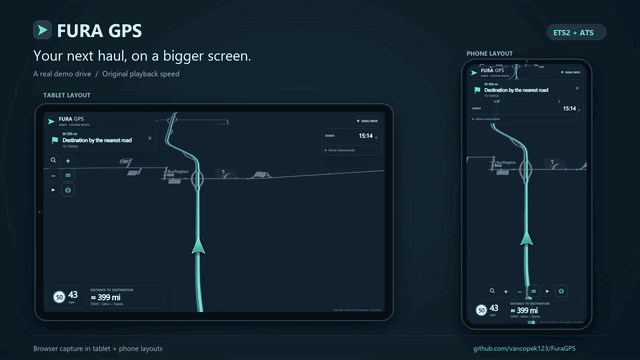
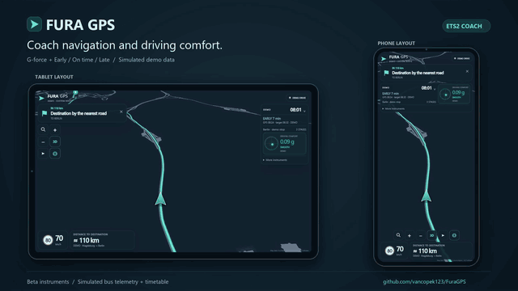

# Fura GPS demo previews

## ATS — Straight-road navigation

This animation shows actual Fura GPS 0.11.1 demo playback on a selected straight road section of the ATS map. Route endpoints were selected for this recording; the application's standard route geometry, demo motion and camera behavior are used. Route movement and instrument values come from demo mode.

- Looping preview: 640 × 360 GIF, 50 fps, 6 seconds.
- Tablet source viewport: 1024 × 600.
- Phone source viewport: 390 × 844.

The interface was recorded in a desktop Chrome browser. The tablet and phone outlines are presentation graphics around those recordings. The animation preserves the original demo playback speed.

The selected section keeps a steady driving direction while the road and nearby junctions move past. It shows heading-up 3D navigation, the vehicle marker, route tracking, speed and distance to destination. Device-specific installation and performance testing are described in the main README's compatibility table.

## ETS2 Coach DLC — Comfort and punctuality (beta)

This animation shows Fura GPS 0.11.1 demo playback on a relatively straight section of the Magdeburg–Berlin ETS2 route. The application renders the map, vehicle marker, G-meter and Coach timetable using its normal demo motion and dashboard logic.

The bus instruments are simulated demo values. The timetable input is scripted to show **Early 7 min**, **On time**, and **Late 7 min**, in that order. The G-meter shows its green, orange and red comfort states during the drive. The scene is marked DEMO, and the presentation also labels the data as simulated.

- Looping preview: a continuous 14-second excerpt, 640 × 360 GIF at 50 fps.
- Tablet source viewport: 1024 × 600.
- Phone source viewport: 390 × 844.

The illustrated device frames contain genuine desktop-browser captures at those viewport sizes. The animation preserves the original demo playback speed. These are beta feature examples; live Coach reader compatibility and device-specific testing are described in the main README.
